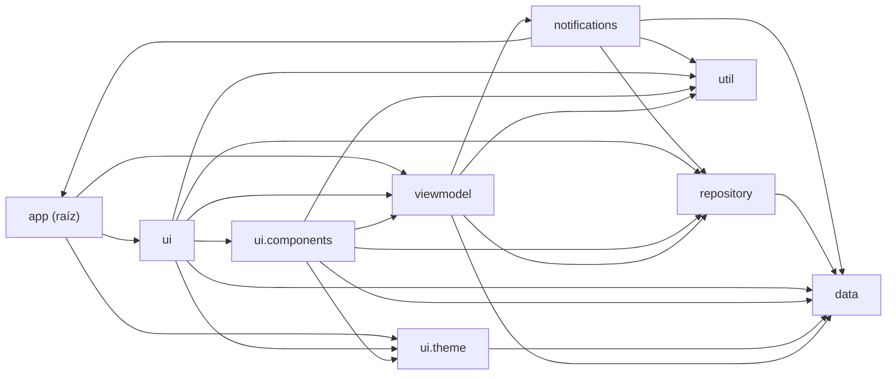

<!-- AUTO-GENERADO por tools/wiki/WikiGenerator.java. No editar a mano. -->
# Arquitectura

> Página generada automáticamente desde el código. Para cambiarla, mejora el KDoc del código y corre `gradlew generateWiki`.

App de un solo módulo (`app`) con capas separadas por paquete. Los datos viven 100% en el teléfono.

## Capas y quién usa a quién

_Las flechas salen de los `import` reales de cada archivo._

| Paquete | Archivos | Líneas | Responsabilidad |
| --- | --- | --- | --- |
| `app (raíz)` | 1 | 54 | Punto de entrada: la actividad que arranca la app. |
| `data` | 11 | 379 | Entidades de Room, DAO, base de datos y stores de DataStore. |
| `notifications` | 2 | 131 | Recordatorios: trabajo diario de WorkManager y notificaciones. |
| `repository` | 4 | 454 | Lógica de negocio y cálculos de dinero. |
| `ui` | 2 | 556 | Pantallas principales de Compose. |
| `ui.components` | 16 | 1741 | Hojas inferiores y componentes reutilizables. |
| `ui.theme` | 2 | 180 | Colores, tipografía y tema Material 3 (claro, oscuro y dinámico). |
| `util` | 1 | 21 | Formato de dinero y fechas. |
| `viewmodel` | 1 | 260 | Estado de la pantalla y acciones del usuario. |

## Archivos por capa

### `app (raíz)`

| Archivo | Declara | Qué hace |
| --- | --- | --- |
| [`MainActivity.kt`](../../app/src/main/java/com/alex/metasahorro/MainActivity.kt) | `MainActivity` | Única actividad de la app: muestra el splash mientras carga las preferencias, aplica el tema elegido y decide entre el onboarding (primera vez) y la pantalla principal. |

### `data`

| Archivo | Declara | Qué hace |
| --- | --- | --- |
| [`AchievementUnlock.kt`](../../app/src/main/java/com/alex/metasahorro/data/AchievementUnlock.kt) | `AchievementUnlock` | Un logro ya desbloqueado. |
| [`AppDao.kt`](../../app/src/main/java/com/alex/metasahorro/data/AppDao.kt) | `AppDao` |  |
| [`AppDatabase.kt`](../../app/src/main/java/com/alex/metasahorro/data/AppDatabase.kt) | `AppDatabase` |  |
| [`Converters.kt`](../../app/src/main/java/com/alex/metasahorro/data/Converters.kt) | `Converters` |  |
| [`Meta.kt`](../../app/src/main/java/com/alex/metasahorro/data/Meta.kt) | `Meta` | Una meta de ahorro activa (algo que Alex quiere comprar). |
| [`Movement.kt`](../../app/src/main/java/com/alex/metasahorro/data/Movement.kt) | `MovementKind`, `MoneyType`, `Movement` | Tipo de movimiento del historial: depósito, retiro, compra de una meta o conversión efectivo/digital. |
| [`OnboardingStore.kt`](../../app/src/main/java/com/alex/metasahorro/data/OnboardingStore.kt) | `OnboardingStore` |  |
| [`PoolState.kt`](../../app/src/main/java/com/alex/metasahorro/data/PoolState.kt) | `PoolState` | Fila única (id siempre 0) con el estado del "pozo" de dinero: cuánto efectivo y cuánto digital hay guardado en total. |
| [`PrefsStore.kt`](../../app/src/main/java/com/alex/metasahorro/data/PrefsStore.kt) | `ReminderSettings`, `PrefsStore` | Ajustes de los recordatorios: aviso diario (si no registraste hoy) a cierta hora, y aviso de metas por vencer. |
| [`Purchased.kt`](../../app/src/main/java/com/alex/metasahorro/data/Purchased.kt) | `Purchased` | Registro histórico de una meta ya comprada (vitrina de "logros"). |
| [`ThemeStore.kt`](../../app/src/main/java/com/alex/metasahorro/data/ThemeStore.kt) | `AccentTheme`, `ThemeMode`, `ThemeStore` | Color de acento elegido (verde, morado, rojo o azul). |

### `notifications`

| Archivo | Declara | Qué hace |
| --- | --- | --- |
| [`Reminders.kt`](../../app/src/main/java/com/alex/metasahorro/notifications/Reminders.kt) | `Reminders` | Programa y muestra los recordatorios. |
| [`ReminderWorker.kt`](../../app/src/main/java/com/alex/metasahorro/notifications/ReminderWorker.kt) | `ReminderWorker` | Trabajo diario: lee la base de datos, arma el plan de avisos y lo muestra. |

### `repository`

| Archivo | Declara | Qué hace |
| --- | --- | --- |
| [`Achievements.kt`](../../app/src/main/java/com/alex/metasahorro/repository/Achievements.kt) | `Achievement`, `AchievementStats`, `achievementsReached` | Logros que se desbloquean solos al cumplir su condición. |
| [`MetasRepository.kt`](../../app/src/main/java/com/alex/metasahorro/repository/MetasRepository.kt) | `normalizeCategory`, `UndoAction`, `MetasRepository` | Deja la categoría lista para guardar: sin espacios sobrantes, cortada al máximo, y null si quedó vacía. |
| [`MoneyMath.kt`](../../app/src/main/java/com/alex/metasahorro/repository/MoneyMath.kt) | `round2`, `splitPurchase`, `computeStreak`, `Contribution`, `suggestedContribution`, `estimateDailyRate`, `estimateCompletion`, `BalancePoint`, `balanceSeries` | Redondea a centavos para que las proporciones no arrastren decimales basura. |
| [`ReminderPlanner.kt`](../../app/src/main/java/com/alex/metasahorro/repository/ReminderPlanner.kt) | `DeadlineAlert`, `ReminderPlan`, `millisUntilNext`, `planReminders` | Una meta con fecha límite a pocos días de vencer. |

### `ui`

| Archivo | Declara | Qué hace |
| --- | --- | --- |
| [`MainScreen.kt`](../../app/src/main/java/com/alex/metasahorro/ui/MainScreen.kt) | `MainScreen` | Pantalla principal: cabecera con racha y accesos, tarjeta resumen del pozo (efectivo vs digital), filtro por categoría, lista de metas con su progreso y botón + para crear una. |
| [`OnboardingScreen.kt`](../../app/src/main/java/com/alex/metasahorro/ui/OnboardingScreen.kt) | `OnboardingScreen` | Introducción de 4 páginas que se muestra solo la primera vez que se abre la app. |

### `ui.components`

| Archivo | Declara | Qué hace |
| --- | --- | --- |
| [`AchievementsSheet.kt`](../../app/src/main/java/com/alex/metasahorro/ui/components/AchievementsSheet.kt) | `AchievementsSheet`, `AchievementUnlockedDialog` | Vitrina de logros: los desbloqueados primero (con su fecha) y luego los que faltan, atenuados y con candado. |
| [`AddEditMetaSheet.kt`](../../app/src/main/java/com/alex/metasahorro/ui/components/AddEditMetaSheet.kt) | `AddEditMetaSheet`, `FieldLabel` | Formulario para crear o editar una meta: nombre, precio, categoría opcional (se puede escribir una o elegir una sugerida), fecha límite opcional y foto opcional. |
| [`Confetti.kt`](../../app/src/main/java/com/alex/metasahorro/ui/components/Confetti.kt) | `ConfettiOverlay` | Lluvia de confeti que se dispara cada vez que "trigger" cambia de valor. |
| [`DepositSheet.kt`](../../app/src/main/java/com/alex/metasahorro/ui/components/DepositSheet.kt) | `DepositSheet`, `MoneyTypeToggle`, `ToggleChip` | Registrar dinero ahorrado: monto (con atajos personalizables, por defecto +5.000, +10.000 y +20.000) y tipo, efectivo o digital. |
| [`DetailsSheet.kt`](../../app/src/main/java/com/alex/metasahorro/ui/components/DetailsSheet.kt) | `DetailsSheet` | Detalle del ahorro: cuánto hay en efectivo, cuánto en digital y el total (con barra de proporción), y un gráfico de cómo ha evolucionado el total en 7, 30 o 90 días o todo el historial. |
| [`EmptyState.kt`](../../app/src/main/java/com/alex/metasahorro/ui/components/EmptyState.kt) | `EmptyState` |  |
| [`HistorySheet.kt`](../../app/src/main/java/com/alex/metasahorro/ui/components/HistorySheet.kt) | `HistorySheet` | Lista cronológica (más reciente primero) de depósitos, retiros, transformaciones y compras. |
| [`InfoSheet.kt`](../../app/src/main/java/com/alex/metasahorro/ui/components/InfoSheet.kt) | `InfoSheet` | Acerca de: nombre de la app, autor y una línea de descripción. |
| [`ItemCard.kt`](../../app/src/main/java/com/alex/metasahorro/ui/components/ItemCard.kt) | `stageIcon`, `ItemCard`, `CategoryPill` | Emoji de la etapa de crecimiento de una meta según su avance (0 a 100). |
| [`ItemMenuSheet.kt`](../../app/src/main/java/com/alex/metasahorro/ui/components/ItemMenuSheet.kt) | `ItemMenuSheet` | Detalle y menú de una meta: foto grande (o ícono de crecimiento), categoría, progreso, fecha límite y pronóstico (cuánto ahorrar para llegar a tiempo y qué día llegarías al ritmo actual). |
| [`PurchasedSheet.kt`](../../app/src/main/java/com/alex/metasahorro/ui/components/PurchasedSheet.kt) | `PurchasedSheet` | Vitrina de logros: las metas ya compradas, con fecha, categoría y precio. |
| [`SavingsChart.kt`](../../app/src/main/java/com/alex/metasahorro/ui/components/SavingsChart.kt) | `SavingsChart` | Gráfico de línea del total ahorrado día a día (curva con área sombreada). |
| [`SettingsSheet.kt`](../../app/src/main/java/com/alex/metasahorro/ui/components/SettingsSheet.kt) | `SettingsSheet` | Ajustes en tres bloques: apariencia (modo claro/oscuro/sistema, colores dinámicos en Android 12+ y color de acento), montos rápidos del botón Registrar, y recordatorios (aviso diario con hora y aviso de metas por vencer). |
| [`Strings.kt`](../../app/src/main/java/com/alex/metasahorro/ui/components/Strings.kt) | `pluralText` | Texto con plural desde `strings.xml` (1 día / 2 días). |
| [`TransformSheet.kt`](../../app/src/main/java/com/alex/metasahorro/ui/components/TransformSheet.kt) | `TransformSheet` | Convertir dinero de efectivo a digital (o al revés) sin cambiar el total ahorrado. |
| [`WithdrawSheet.kt`](../../app/src/main/java/com/alex/metasahorro/ui/components/WithdrawSheet.kt) | `WithdrawSheet` | Restar dinero del pozo. |

### `ui.theme`

| Archivo | Declara | Qué hace |
| --- | --- | --- |
| [`Theme.kt`](../../app/src/main/java/com/alex/metasahorro/ui/theme/Theme.kt) | `AppColors`, `AccentPair`, `accentFor`, `MetasAhorroTheme` | Colores propios de la app que Material no cubre (superficies, bordes, texto atenuado y los colores de efectivo/digital). |
| [`Type.kt`](../../app/src/main/java/com/alex/metasahorro/ui/theme/Type.kt) | — |  |

### `util`

| Archivo | Declara | Qué hace |
| --- | --- | --- |
| [`Format.kt`](../../app/src/main/java/com/alex/metasahorro/util/Format.kt) | `fmtMoney`, `fmtNumber`, `fmtDateShort`, `fmtDateTime` | Dinero en pesos chilenos, sin decimales y con punto de miles: `$150.000`. |

### `viewmodel`

| Archivo | Declara | Qué hace |
| --- | --- | --- |
| [`MetasViewModel.kt`](../../app/src/main/java/com/alex/metasahorro/viewmodel/MetasViewModel.kt) | `MetaConSaldo`, `MetasUiState`, `UiEvent`, `MetasViewModel` | Una meta junto con cuánto lleva ahorrado y si ya está completa. |

## Manifest

- **Permisos:** `android.permission.POST_NOTIFICATIONS`
- **Etiqueta:** `Mis Metas`
- **allowBackup:** `true`
- **Actividad:** `.MainActivity` (exported=true)
