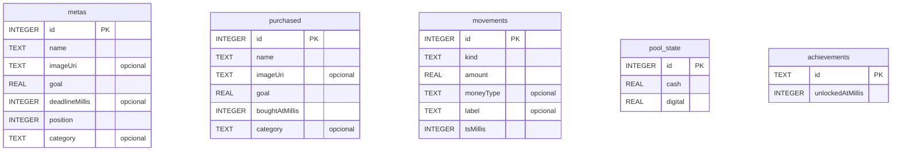

<!-- AUTO-GENERADO por tools/wiki/WikiGenerator.java. No editar a mano. -->
# Modelo de datos

> Página generada automáticamente desde el código. Para cambiarla, mejora el KDoc del código y corre `gradlew generateWiki`.

Todo se guarda localmente con Room (SQLite) y DataStore. No hay servidor.

**Versión del esquema:** 2 · **identityHash:** `3333da4e505c1111b6fb82be0bd94a0b`

## Diagrama



_Las tablas son independientes: no hay claves foráneas._

## Tablas

### `achievements` (`AchievementUnlock`)

Un logro ya desbloqueado. `id` es el nombre del enum `Achievement`; guardar cuándo se obtuvo evita celebrarlo dos veces y permite mostrar la fecha en la vitrina de logros.

Código: [`AchievementUnlock.kt`](../../app/src/main/java/com/alex/metasahorro/data/AchievementUnlock.kt)

| Campo | Tipo Kotlin | Nulo | Por defecto |
| --- | --- | --- | --- |
| `id` | `String` | no | — |
| `unlockedAtMillis` | `Long` | no | — |

```sql
CREATE TABLE IF NOT EXISTS `achievements` (`id` TEXT NOT NULL, `unlockedAtMillis` INTEGER NOT NULL, PRIMARY KEY(`id`))
```

### `metas` (`Meta`)

Una meta de ahorro activa (algo que Alex quiere comprar). "position" define el orden manual en la lista (se puede reordenar con las flechas). "deadlineMillis" es opcional: fecha límite autoimpuesta. "category" es una etiqueta opcional de texto libre (Tecnología, Viajes...) para agrupar y filtrar.

Código: [`Meta.kt`](../../app/src/main/java/com/alex/metasahorro/data/Meta.kt)

| Campo | Tipo Kotlin | Nulo | Por defecto |
| --- | --- | --- | --- |
| `id` | `Long` | no | `0` |
| `name` | `String` | no | — |
| `imageUri` | `String?` | sí | `null` |
| `goal` | `Double` | no | — |
| `deadlineMillis` | `Long?` | sí | `null` |
| `position` | `Int` | no | `0` |
| `category` | `String?` | sí | `null` |

```sql
CREATE TABLE IF NOT EXISTS `metas` (`id` INTEGER PRIMARY KEY AUTOINCREMENT NOT NULL, `name` TEXT NOT NULL, `imageUri` TEXT, `goal` REAL NOT NULL, `deadlineMillis` INTEGER, `position` INTEGER NOT NULL, `category` TEXT)
```

### `movements` (`Movement`)

Una línea del historial. `moneyType` solo aplica a depósitos y retiros; `label` guarda el nombre de la meta (compras) o el sentido de la conversión (transformaciones).

Código: [`Movement.kt`](../../app/src/main/java/com/alex/metasahorro/data/Movement.kt)

| Campo | Tipo Kotlin | Nulo | Por defecto |
| --- | --- | --- | --- |
| `id` | `Long` | no | `0` |
| `kind` | `MovementKind` | no | — |
| `amount` | `Double` | no | — |
| `moneyType` | `MoneyType?` | sí | `null` |
| `label` | `String?` | sí | `null` |
| `tsMillis` | `Long` | no | — |

```sql
CREATE TABLE IF NOT EXISTS `movements` (`id` INTEGER PRIMARY KEY AUTOINCREMENT NOT NULL, `kind` TEXT NOT NULL, `amount` REAL NOT NULL, `moneyType` TEXT, `label` TEXT, `tsMillis` INTEGER NOT NULL)
```

### `pool_state` (`PoolState`)

Fila única (id siempre 0) con el estado del "pozo" de dinero: cuánto efectivo y cuánto digital hay guardado en total. No se reparte entre metas: cada meta compara su precio contra (cash + digital).

Código: [`PoolState.kt`](../../app/src/main/java/com/alex/metasahorro/data/PoolState.kt)

| Campo | Tipo Kotlin | Nulo | Por defecto |
| --- | --- | --- | --- |
| `id` | `Int` | no | `0` |
| `cash` | `Double` | no | `0.0` |
| `digital` | `Double` | no | `0.0` |

```sql
CREATE TABLE IF NOT EXISTS `pool_state` (`id` INTEGER NOT NULL, `cash` REAL NOT NULL, `digital` REAL NOT NULL, PRIMARY KEY(`id`))
```

### `purchased` (`Purchased`)

Registro histórico de una meta ya comprada (vitrina de "logros"). Conserva la categoría que tenía la meta.

Código: [`Purchased.kt`](../../app/src/main/java/com/alex/metasahorro/data/Purchased.kt)

| Campo | Tipo Kotlin | Nulo | Por defecto |
| --- | --- | --- | --- |
| `id` | `Long` | no | `0` |
| `name` | `String` | no | — |
| `imageUri` | `String?` | sí | `null` |
| `goal` | `Double` | no | — |
| `boughtAtMillis` | `Long` | no | — |
| `category` | `String?` | sí | `null` |

```sql
CREATE TABLE IF NOT EXISTS `purchased` (`id` INTEGER PRIMARY KEY AUTOINCREMENT NOT NULL, `name` TEXT NOT NULL, `imageUri` TEXT, `goal` REAL NOT NULL, `boughtAtMillis` INTEGER NOT NULL, `category` TEXT)
```

## Enums

- **`MovementKind`** ([`Movement.kt`](../../app/src/main/java/com/alex/metasahorro/data/Movement.kt)): `DEPOSIT`, `WITHDRAW`, `PURCHASE`, `TRANSFORM` — Tipo de movimiento del historial: depósito, retiro, compra de una meta o conversión efectivo/digital.
- **`MoneyType`** ([`Movement.kt`](../../app/src/main/java/com/alex/metasahorro/data/Movement.kt)): `EFECTIVO`, `DIGITAL` — De qué forma está guardado el dinero.
- **`AccentTheme`** ([`ThemeStore.kt`](../../app/src/main/java/com/alex/metasahorro/data/ThemeStore.kt)): `GREEN(R.string.accent_green)`, `PURPLE(R.string.accent_purple)`, `RED(R.string.accent_red)`, `BLUE(R.string.accent_blue)` — Color de acento elegido (verde, morado, rojo o azul). Se ignora si están activados los colores dinámicos.
- **`ThemeMode`** ([`ThemeStore.kt`](../../app/src/main/java/com/alex/metasahorro/data/ThemeStore.kt)): `SYSTEM(R.string.mode_system)`, `LIGHT(R.string.mode_light)`, `DARK(R.string.mode_dark)` — Apariencia general: seguir al sistema, siempre claro o siempre oscuro.
- **`Achievement`** ([`Achievements.kt`](../../app/src/main/java/com/alex/metasahorro/repository/Achievements.kt)): `FIRST_DEPOSIT("🌱", R.string.ach_first_deposit_title, R.string.ach_first_deposit_desc)`, `STREAK_3("🔥", R.string.ach_streak3_title, R.string.ach_streak3_desc)`, `STREAK_7("⚡", R.string.ach_streak7_title, R.string.ach_streak7_desc)`, `STREAK_30("🏅", R.string.ach_streak30_title, R.string.ach_streak30_desc)`, `FIRST_PURCHASE("🏆", R.string.ach_first_purchase_title, R.string.ach_first_purchase_desc)`, `PURCHASES_5("🛍️", R.string.ach_purchases5_title, R.string.ach_purchases5_desc)`, `SAVED_100K("💰", R.string.ach_saved100k_title, R.string.ach_saved100k_desc)`, `SAVED_500K("💎", R.string.ach_saved500k_title, R.string.ach_saved500k_desc)`, `SAVED_1M("👑", R.string.ach_saved1m_title, R.string.ach_saved1m_desc)`, `FIRST_TRANSFORM("🔁", R.string.ach_transform_title, R.string.ach_transform_desc)`, `CATEGORIES_3("🏷️", R.string.ach_categories_title, R.string.ach_categories_desc)` — Logros que se desbloquean solos al cumplir su condición. El nombre del enum es el id que se guarda en Room.

## Preferencias (DataStore)

| Archivo | DataStore | Clave | Tipo |
| --- | --- | --- | --- |
| [`OnboardingStore.kt`](../../app/src/main/java/com/alex/metasahorro/data/OnboardingStore.kt) | `onboarding` | `seen_onboarding` | boolean |
| [`PrefsStore.kt`](../../app/src/main/java/com/alex/metasahorro/data/PrefsStore.kt) | `prefs` | `quick_amounts` | string |
| [`PrefsStore.kt`](../../app/src/main/java/com/alex/metasahorro/data/PrefsStore.kt) | `prefs` | `reminder_daily` | boolean |
| [`PrefsStore.kt`](../../app/src/main/java/com/alex/metasahorro/data/PrefsStore.kt) | `prefs` | `reminder_hour` | int |
| [`PrefsStore.kt`](../../app/src/main/java/com/alex/metasahorro/data/PrefsStore.kt) | `prefs` | `reminder_deadline` | boolean |
| [`PrefsStore.kt`](../../app/src/main/java/com/alex/metasahorro/data/PrefsStore.kt) | `prefs` | `achievements_seeded` | boolean |
| [`ThemeStore.kt`](../../app/src/main/java/com/alex/metasahorro/data/ThemeStore.kt) | `settings` | `accent_theme` | string |
| [`ThemeStore.kt`](../../app/src/main/java/com/alex/metasahorro/data/ThemeStore.kt) | `settings` | `theme_mode` | string |
| [`ThemeStore.kt`](../../app/src/main/java/com/alex/metasahorro/data/ThemeStore.kt) | `settings` | `dynamic_color` | boolean |

## Consultas (DAO)

Origen: [`AppDao.kt`](../../app/src/main/java/com/alex/metasahorro/data/AppDao.kt)

**Metas activas**

| Función | Tipo | Ejecución | SQL |
| --- | --- | --- | --- |
| `observeMetas` | Query | Flow | `SELECT * FROM metas ORDER BY position ASC` |
| `getMetas` | Query | suspend | `SELECT * FROM metas ORDER BY position ASC` |
| `insertMeta` | Insert | suspend | — |
| `updateMeta` | Update | suspend | — |
| `deleteMeta` | Delete | suspend | — |
| `nextPosition` | Query | suspend | `SELECT COALESCE(MAX(position), -1) + 1 FROM metas` |

**Comprados**

| Función | Tipo | Ejecución | SQL |
| --- | --- | --- | --- |
| `observePurchased` | Query | Flow | `SELECT * FROM purchased ORDER BY boughtAtMillis DESC` |
| `insertPurchased` | Insert | suspend | — |
| `deletePurchased` | Query | suspend | `DELETE FROM purchased WHERE id = :id` |

**Historial de movimientos**

| Función | Tipo | Ejecución | SQL |
| --- | --- | --- | --- |
| `observeMovements` | Query | Flow | `SELECT * FROM movements ORDER BY tsMillis DESC` |
| `getMovements` | Query | suspend | `SELECT * FROM movements ORDER BY tsMillis DESC` |
| `getMovement` | Query | suspend | `SELECT * FROM movements WHERE id = :id` |
| `insertMovement` | Insert | suspend | — |
| `deleteMovement` | Query | suspend | `DELETE FROM movements WHERE id = :id` |

**Pozo de dinero (fila única)**

| Función | Tipo | Ejecución | SQL |
| --- | --- | --- | --- |
| `observePool` | Query | Flow | `SELECT * FROM pool_state WHERE id = 0` |
| `getPool` | Query | suspend | `SELECT * FROM pool_state WHERE id = 0` |
| `upsertPool` | Insert | suspend | — |

**Logros**

| Función | Tipo | Ejecución | SQL |
| --- | --- | --- | --- |
| `observeAchievements` | Query | Flow | `SELECT * FROM achievements` |
| `insertAchievement` | Insert | suspend | — |
