<!-- AUTO-GENERADO por tools/wiki/WikiGenerator.java. No editar a mano. -->
# Pantallas

> Página generada automáticamente desde el código. Para cambiarla, mejora el KDoc del código y corre `gradlew generateWiki`.

Una pantalla principal y varias hojas inferiores (bottom sheets) que se abren encima. Las capturas se toman en el emulador con datos de ejemplo.

## Cómo se abre cada vista

`MainScreen` guarda un estado `SheetType`; cada callback de abajo lo cambia y se muestra la hoja correspondiente.

| Callback | Estado | Se muestra |
| --- | --- | --- |
| `onHistory` | `HISTORY` | [HistorySheet](#historysheet) |
| `onPurchased` | `PURCHASED` | [PurchasedSheet](#purchasedsheet) |
| `onAchievements` | `ACHIEVEMENTS` | [AchievementsSheet](#achievementssheet) |
| `onDetails` | `DETAILS` | [DetailsSheet](#detailssheet) |
| `onSettings` | `SETTINGS` | [SettingsSheet](#settingssheet) |
| `onInfo` | `INFO` | [InfoSheet](#infosheet) |
| `onRegistrar` | `DEPOSIT` | [DepositSheet](#depositsheet) |
| `onRestar` | `WITHDRAW` | [WithdrawSheet](#withdrawsheet) |
| `onTransformar` | `TRANSFORM` | [TransformSheet](#transformsheet) |
| `onClick` | `ITEM_MENU` | [ItemMenuSheet](#itemmenusheet) |
| `onClick` | `ADD` | [AddEditMetaSheet](#addeditmetasheet) |
| `onEditar` | `EDIT` | [AddEditMetaSheet](#addeditmetasheet) |

## Pantallas

### MainScreen

Pantalla principal: cabecera con racha y accesos, tarjeta resumen del pozo (efectivo vs digital), filtro por categoría, lista de metas con su progreso y botón + para crear una. Todas las demás vistas se abren como hojas inferiores. También muestra los avisos con "Deshacer" y las celebraciones (confeti y logros nuevos).

Código: [`MainScreen.kt`](../../app/src/main/java/com/alex/metasahorro/ui/MainScreen.kt)

<table><tr>
<td align="center">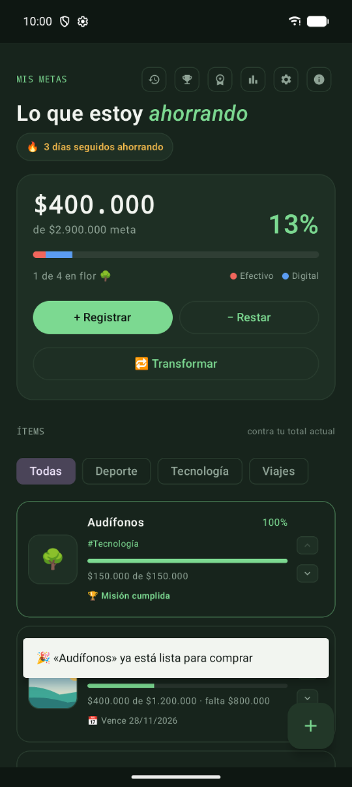</td>
<td align="center">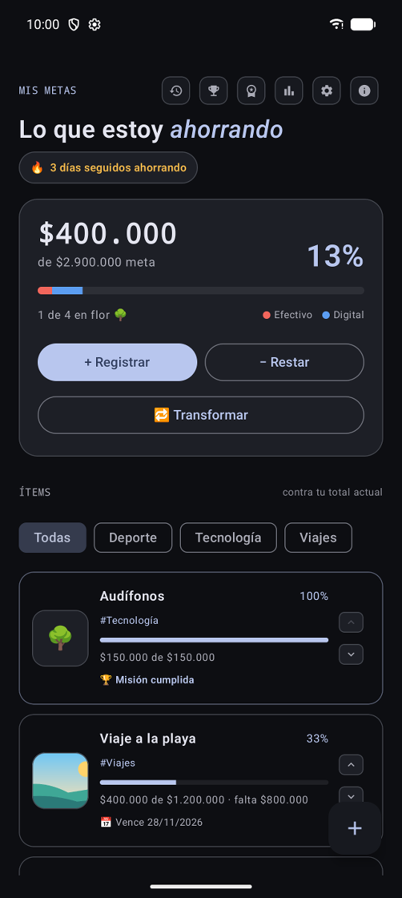 colores dinamicos</td>
<td align="center">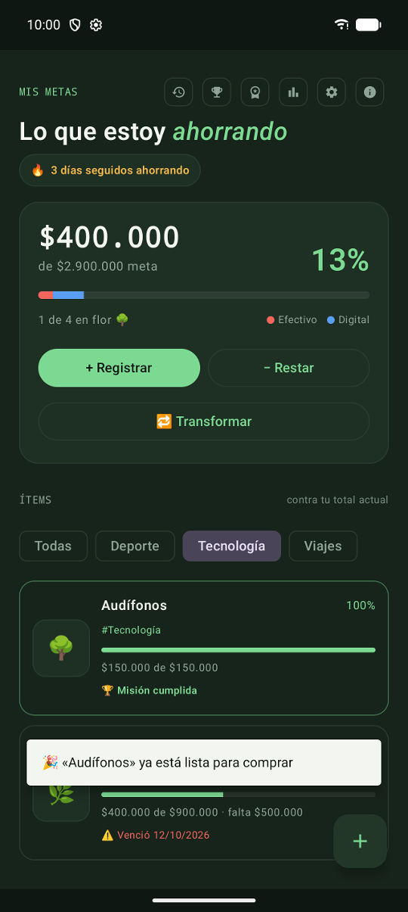 filtro categoria</td>
<td align="center"> meta borrada deshacer</td>
<td align="center">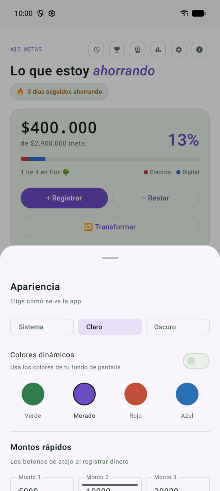 modo claro</td>
<td align="center">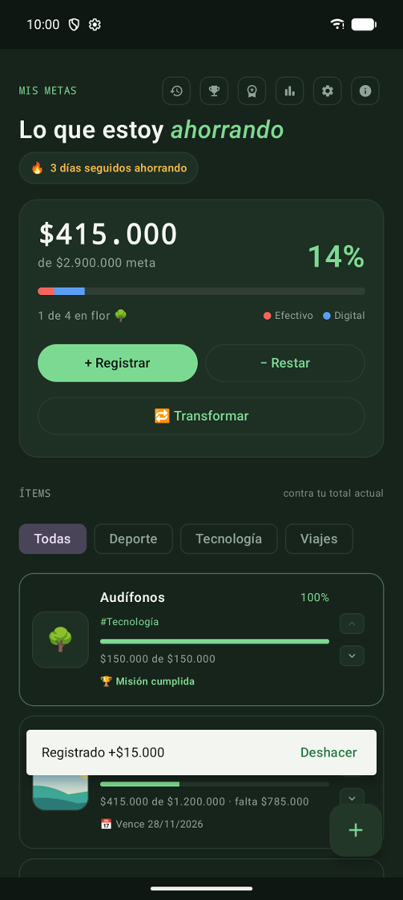 registrado deshacer</td>
<td align="center">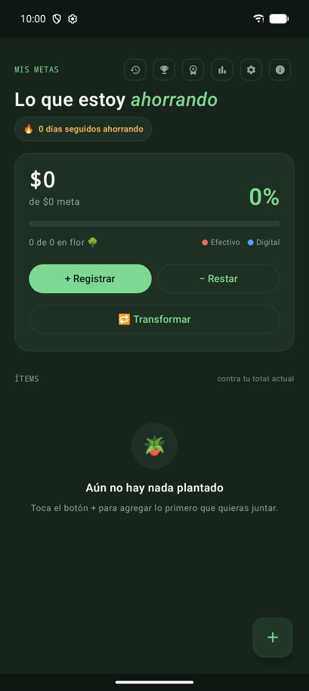 vacio</td>
</tr></table>

| Parámetro | Tipo | Por defecto |
| --- | --- | --- |
| `viewModel` | `MetasViewModel` | — |

### OnboardingScreen

Introducción de 4 páginas que se muestra solo la primera vez que se abre la app.

Código: [`OnboardingScreen.kt`](../../app/src/main/java/com/alex/metasahorro/ui/OnboardingScreen.kt)

<table><tr>
<td align="center">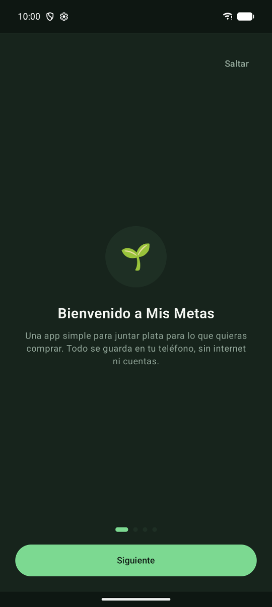</td>
<td align="center">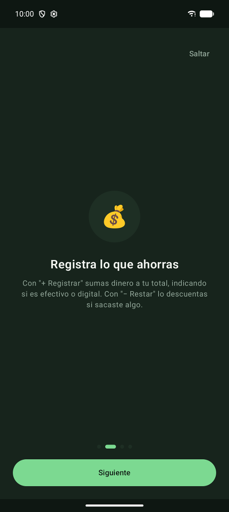 pagina 2</td>
<td align="center">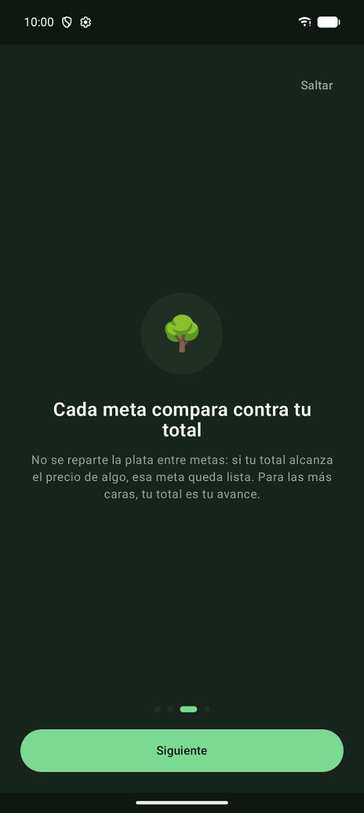 pagina 3</td>
<td align="center"> pagina 4</td>
</tr></table>

| Parámetro | Tipo | Por defecto |
| --- | --- | --- |
| `onFinish` | `() -> Unit` | — |

## Hojas inferiores

### AchievementsSheet

Vitrina de logros: los desbloqueados primero (con su fecha) y luego los que faltan, atenuados y con candado.

Código: [`AchievementsSheet.kt`](../../app/src/main/java/com/alex/metasahorro/ui/components/AchievementsSheet.kt)

<table><tr>
<td align="center">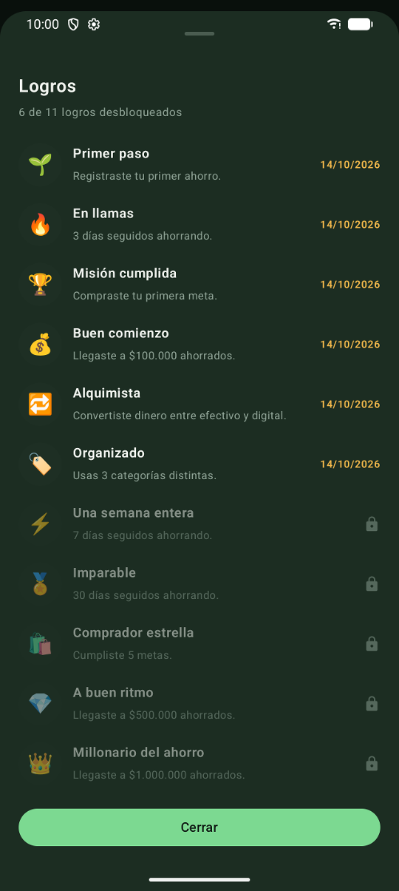</td>
</tr></table>

| Parámetro | Tipo | Por defecto |
| --- | --- | --- |
| `unlocked` | `List<AchievementUnlock>` | — |
| `onDismiss` | `() -> Unit` | — |

### AddEditMetaSheet

Formulario para crear o editar una meta: nombre, precio, categoría opcional (se puede escribir una o elegir una sugerida), fecha límite opcional y foto opcional. `categories` son las que ya se usan en la app.

Código: [`AddEditMetaSheet.kt`](../../app/src/main/java/com/alex/metasahorro/ui/components/AddEditMetaSheet.kt)

<table><tr>
<td align="center">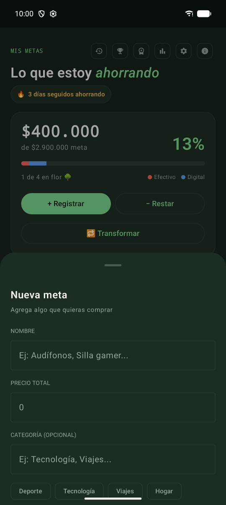</td>
<td align="center">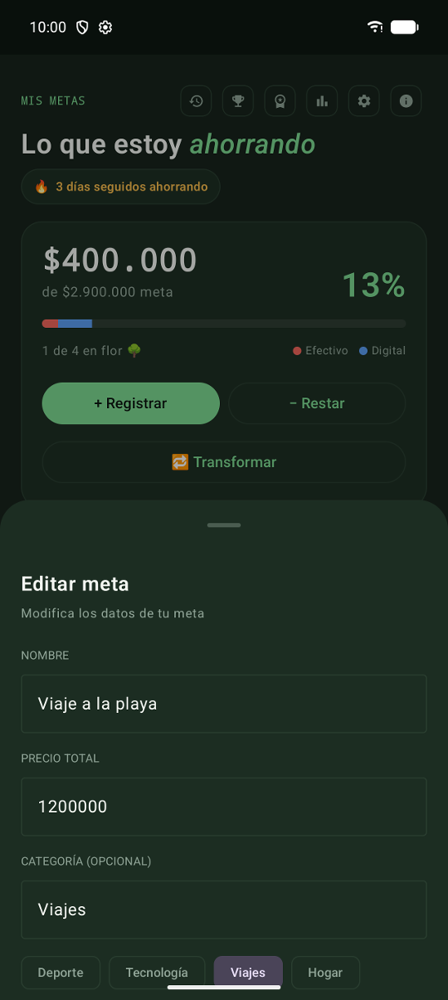 editar</td>
</tr></table>

| Parámetro | Tipo | Por defecto |
| --- | --- | --- |
| `editing` | `Meta?` | — |
| `categories` | `List<String>` | — |
| `onDismiss` | `() -> Unit` | — |
| `onSave` | `(name: String, imageUri: String?, goal: Double, deadlineMillis: Long?, category: String?) -> Unit` | — |

### DepositSheet

Registrar dinero ahorrado: monto (con atajos personalizables, por defecto +5.000, +10.000 y +20.000) y tipo, efectivo o digital.

Código: [`DepositSheet.kt`](../../app/src/main/java/com/alex/metasahorro/ui/components/DepositSheet.kt)

<table><tr>
<td align="center">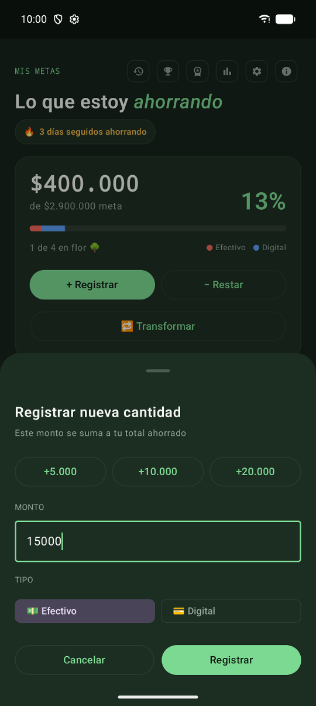</td>
</tr></table>

| Parámetro | Tipo | Por defecto |
| --- | --- | --- |
| `quickAmounts` | `List<Int>` | — |
| `onDismiss` | `() -> Unit` | — |
| `onConfirm` | `(amount: Double, type: MoneyType) -> Unit` | — |

### DetailsSheet

Detalle del ahorro: cuánto hay en efectivo, cuánto en digital y el total (con barra de proporción), y un gráfico de cómo ha evolucionado el total en 7, 30 o 90 días o todo el historial.

Código: [`DetailsSheet.kt`](../../app/src/main/java/com/alex/metasahorro/ui/components/DetailsSheet.kt)

<table><tr>
<td align="center">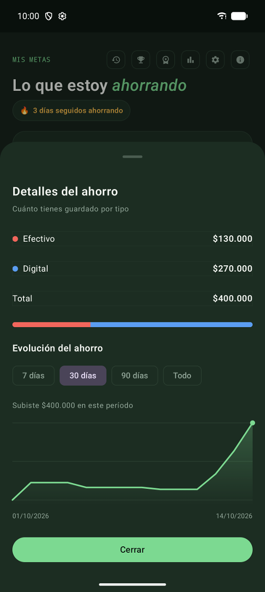</td>
</tr></table>

| Parámetro | Tipo | Por defecto |
| --- | --- | --- |
| `pool` | `PoolState` | — |
| `movements` | `List<Movement>` | — |
| `onDismiss` | `() -> Unit` | — |

### HistorySheet

Lista cronológica (más reciente primero) de depósitos, retiros, transformaciones y compras. Los depósitos, retiros y transformaciones se pueden borrar (con confirmación): se revierte su efecto en el ahorro.

Código: [`HistorySheet.kt`](../../app/src/main/java/com/alex/metasahorro/ui/components/HistorySheet.kt)

<table><tr>
<td align="center">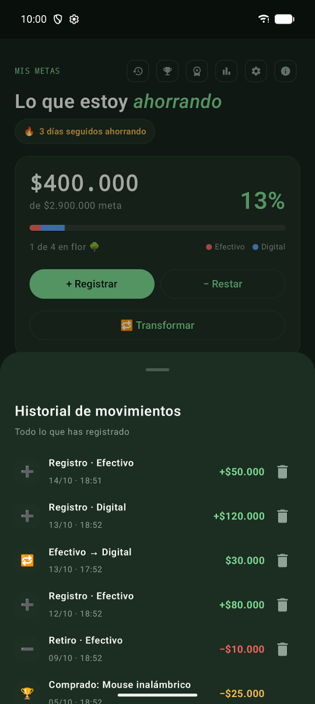</td>
</tr></table>

| Parámetro | Tipo | Por defecto |
| --- | --- | --- |
| `movements` | `List<Movement>` | — |
| `onDelete` | `(Movement) -> Unit` | — |
| `onDismiss` | `() -> Unit` | — |

### InfoSheet

Acerca de: nombre de la app, autor y una línea de descripción.

Código: [`InfoSheet.kt`](../../app/src/main/java/com/alex/metasahorro/ui/components/InfoSheet.kt)

<table><tr>
<td align="center">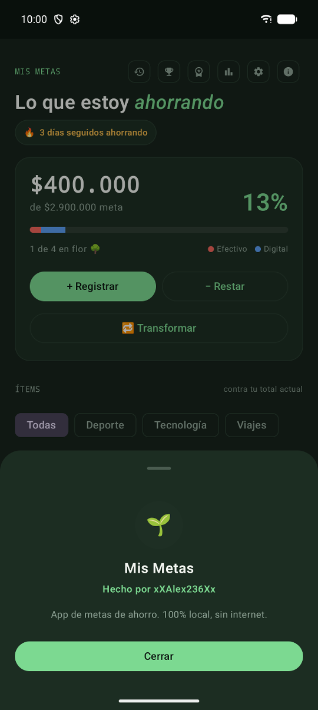</td>
</tr></table>

| Parámetro | Tipo | Por defecto |
| --- | --- | --- |
| `onDismiss` | `() -> Unit` | — |

### ItemMenuSheet

Detalle y menú de una meta: foto grande (o ícono de crecimiento), categoría, progreso, fecha límite y pronóstico (cuánto ahorrar para llegar a tiempo y qué día llegarías al ritmo actual). Permite marcarla como comprada si ya está completa, modificarla o borrarla.

Código: [`ItemMenuSheet.kt`](../../app/src/main/java/com/alex/metasahorro/ui/components/ItemMenuSheet.kt)

<table><tr>
<td align="center">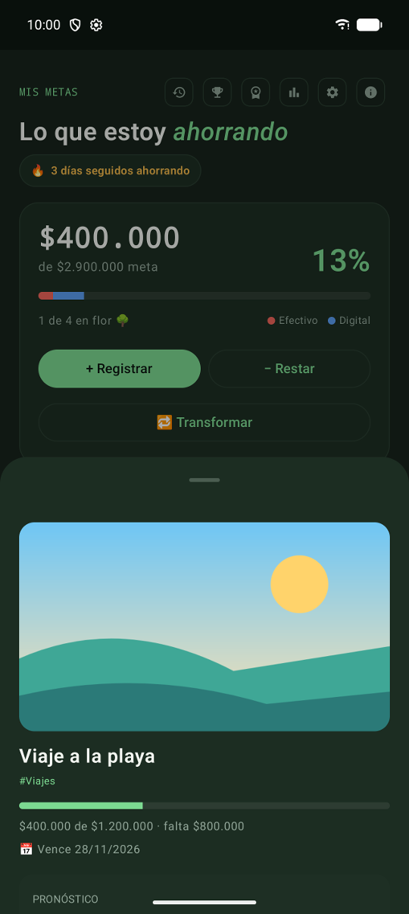</td>
<td align="center">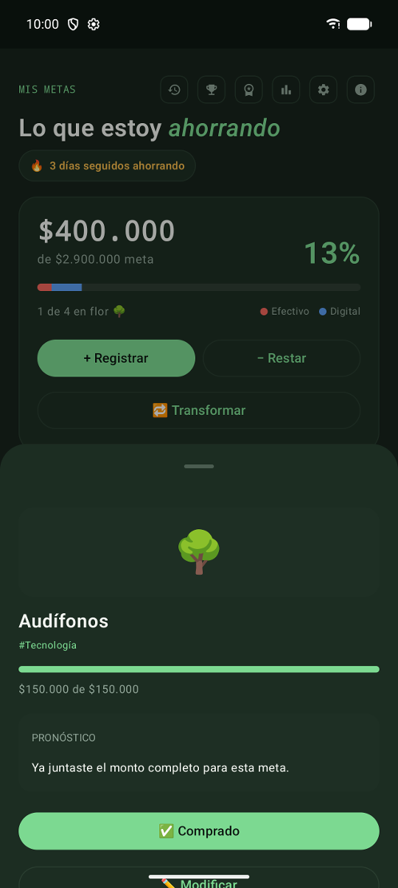 completa</td>
<td align="center">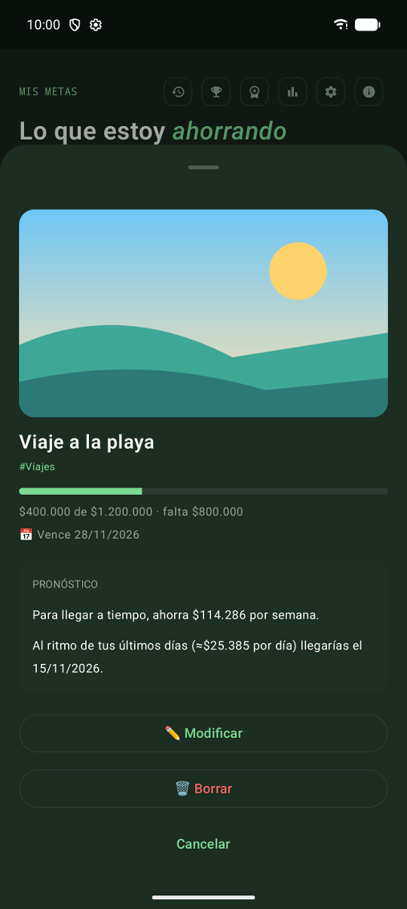 pronostico</td>
</tr></table>

| Parámetro | Tipo | Por defecto |
| --- | --- | --- |
| `item` | `MetaConSaldo` | — |
| `movements` | `List<Movement>` | — |
| `onDismiss` | `() -> Unit` | — |
| `onEditar` | `() -> Unit` | — |
| `onBorrar` | `() -> Unit` | — |
| `onComprado` | `() -> Unit` | — |

### PurchasedSheet

Vitrina de logros: las metas ya compradas, con fecha, categoría y precio.

Código: [`PurchasedSheet.kt`](../../app/src/main/java/com/alex/metasahorro/ui/components/PurchasedSheet.kt)

<table><tr>
<td align="center">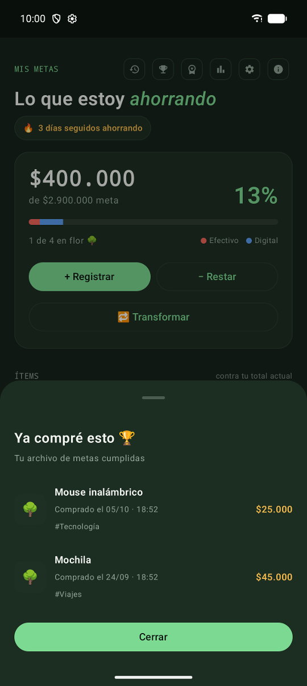</td>
</tr></table>

| Parámetro | Tipo | Por defecto |
| --- | --- | --- |
| `purchased` | `List<Purchased>` | — |
| `onDismiss` | `() -> Unit` | — |

### SettingsSheet

Ajustes en tres bloques: apariencia (modo claro/oscuro/sistema, colores dinámicos en Android 12+ y color de acento), montos rápidos del botón Registrar, y recordatorios (aviso diario con hora y aviso de metas por vencer). Activar un recordatorio pide el permiso de notificaciones en Android 13+.

Código: [`SettingsSheet.kt`](../../app/src/main/java/com/alex/metasahorro/ui/components/SettingsSheet.kt)

<table><tr>
<td align="center"></td>
<td align="center"> colores dinamicos</td>
<td align="center"> modo claro</td>
<td align="center"> montos y recordatorios</td>
<td align="center"> tema morado</td>
</tr></table>

| Parámetro | Tipo | Por defecto |
| --- | --- | --- |
| `theme` | `AccentTheme` | — |
| `mode` | `ThemeMode` | — |
| `dynamicColor` | `Boolean` | — |
| `quickAmounts` | `List<Int>` | — |
| `reminders` | `ReminderSettings` | — |
| `onDismiss` | `() -> Unit` | — |
| `onTheme` | `(AccentTheme) -> Unit` | — |
| `onMode` | `(ThemeMode) -> Unit` | — |
| `onDynamicColor` | `(Boolean) -> Unit` | — |
| `onQuickAmounts` | `(List<Int>) -> Unit` | — |
| `onDailyReminder` | `(Boolean) -> Unit` | — |
| `onReminderHour` | `(Int) -> Unit` | — |
| `onDeadlineReminder` | `(Boolean) -> Unit` | — |

### TransformSheet

Convertir dinero de efectivo a digital (o al revés) sin cambiar el total ahorrado.

Código: [`TransformSheet.kt`](../../app/src/main/java/com/alex/metasahorro/ui/components/TransformSheet.kt)

<table><tr>
<td align="center">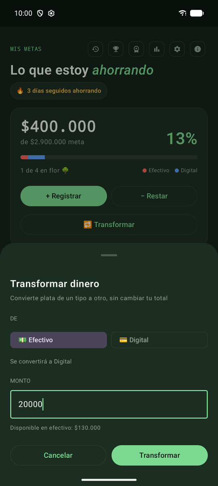</td>
</tr></table>

| Parámetro | Tipo | Por defecto |
| --- | --- | --- |
| `pool` | `PoolState` | — |
| `onDismiss` | `() -> Unit` | — |
| `onConfirm` | `(amount: Double, from: MoneyType) -> Unit` | — |

### WithdrawSheet

Restar dinero del pozo. Valida que haya saldo suficiente en el tipo elegido antes de confirmar.

Código: [`WithdrawSheet.kt`](../../app/src/main/java/com/alex/metasahorro/ui/components/WithdrawSheet.kt)

<table><tr>
<td align="center">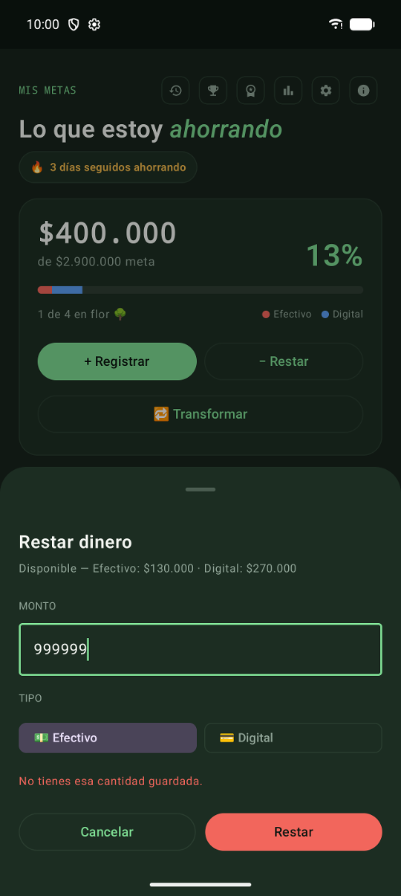 error sin saldo</td>
</tr></table>

| Parámetro | Tipo | Por defecto |
| --- | --- | --- |
| `pool` | `PoolState` | — |
| `onDismiss` | `() -> Unit` | — |
| `onConfirm` | `(amount: Double, type: MoneyType) -> Unit` | — |

## Componentes

### AchievementUnlockedDialog

Aviso de celebración cuando se desbloquean uno o más logros a la vez.

Código: [`AchievementsSheet.kt`](../../app/src/main/java/com/alex/metasahorro/ui/components/AchievementsSheet.kt)

<table><tr>
<td align="center">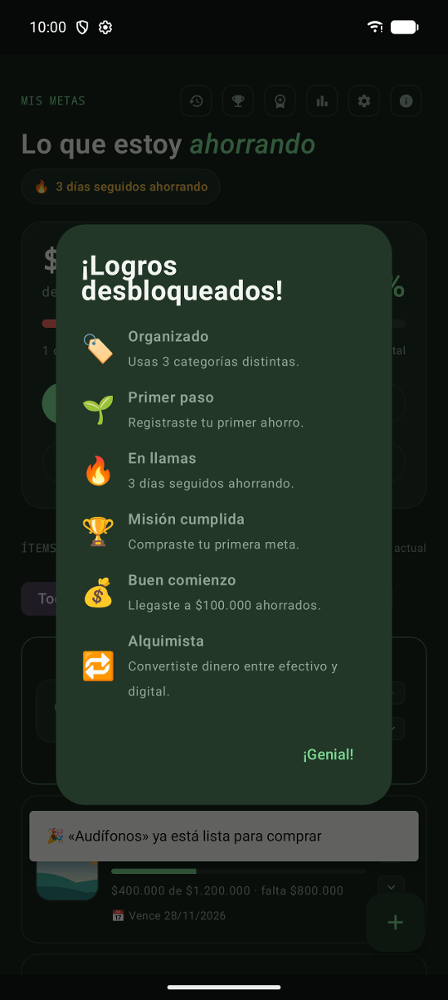</td>
</tr></table>

| Parámetro | Tipo | Por defecto |
| --- | --- | --- |
| `list` | `List<Achievement>` | — |
| `onDismiss` | `() -> Unit` | — |

### CategoryPill

Etiqueta pequeña con la categoría de la meta.

Código: [`ItemCard.kt`](../../app/src/main/java/com/alex/metasahorro/ui/components/ItemCard.kt)

| Parámetro | Tipo | Por defecto |
| --- | --- | --- |
| `text` | `String` | — |

### ConfettiOverlay

Lluvia de confeti que se dispara cada vez que "trigger" cambia de valor. Se superpone sobre la pantalla mientras dura la animación (~1.3s) y luego desaparece sola.

Código: [`Confetti.kt`](../../app/src/main/java/com/alex/metasahorro/ui/components/Confetti.kt)

| Parámetro | Tipo | Por defecto |
| --- | --- | --- |
| `trigger` | `Int` | — |
| `modifier` | `Modifier` | `Modifier` |

### EmptyState

Código: [`EmptyState.kt`](../../app/src/main/java/com/alex/metasahorro/ui/components/EmptyState.kt)

| Parámetro | Tipo | Por defecto |
| --- | --- | --- |
| `icon` | `String` | — |
| `title` | `String` | — |
| `subtitle` | `String` | — |

### FieldLabel

Etiqueta pequeña en mayúsculas sobre un campo de formulario.

Código: [`AddEditMetaSheet.kt`](../../app/src/main/java/com/alex/metasahorro/ui/components/AddEditMetaSheet.kt)

| Parámetro | Tipo | Por defecto |
| --- | --- | --- |
| `text` | `String` | — |

### ItemCard

Tarjeta de una meta: foto o ícono de crecimiento, categoría, progreso, lo que falta, fecha límite y flechas para reordenar (que se ocultan con `showReorder = false`, por ejemplo mientras la lista está filtrada).

Código: [`ItemCard.kt`](../../app/src/main/java/com/alex/metasahorro/ui/components/ItemCard.kt)

| Parámetro | Tipo | Por defecto |
| --- | --- | --- |
| `item` | `MetaConSaldo` | — |
| `isFirst` | `Boolean` | — |
| `isLast` | `Boolean` | — |
| `showReorder` | `Boolean` | — |
| `onClick` | `() -> Unit` | — |
| `onMoveUp` | `() -> Unit` | — |
| `onMoveDown` | `() -> Unit` | — |

### MoneyTypeToggle

Selector de dos opciones, efectivo o digital.

Código: [`DepositSheet.kt`](../../app/src/main/java/com/alex/metasahorro/ui/components/DepositSheet.kt)

| Parámetro | Tipo | Por defecto |
| --- | --- | --- |
| `selected` | `MoneyType` | — |
| `onSelect` | `(MoneyType) -> Unit` | — |

### SavingsChart

Gráfico de línea del total ahorrado día a día (curva con área sombreada). Dibuja solo con Canvas, sin librerías. Bajo el gráfico muestra la fecha inicial y final; el resumen accesible describe el cambio del período.

Código: [`SavingsChart.kt`](../../app/src/main/java/com/alex/metasahorro/ui/components/SavingsChart.kt)

| Parámetro | Tipo | Por defecto |
| --- | --- | --- |
| `points` | `List<BalancePoint>` | — |
| `modifier` | `Modifier` | `Modifier` |

### ToggleChip

Botón de opción seleccionable (chip).

Código: [`DepositSheet.kt`](../../app/src/main/java/com/alex/metasahorro/ui/components/DepositSheet.kt)

| Parámetro | Tipo | Por defecto |
| --- | --- | --- |
| `label` | `String` | — |
| `selected` | `Boolean` | — |
| `modifier` | `Modifier` | `Modifier` |
| `onClick` | `() -> Unit` | — |

### pluralText

Texto con plural desde `strings.xml` (1 día / 2 días). `args` se insertan en el texto, normalmente la cantidad misma.

Código: [`Strings.kt`](../../app/src/main/java/com/alex/metasahorro/ui/components/Strings.kt)

| Parámetro | Tipo | Por defecto |
| --- | --- | --- |
| `id` | `Int` | — |
| `count` | `Int` | — |
| `vararg args` | `Any` | — |
