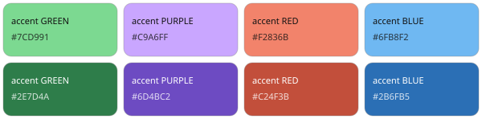
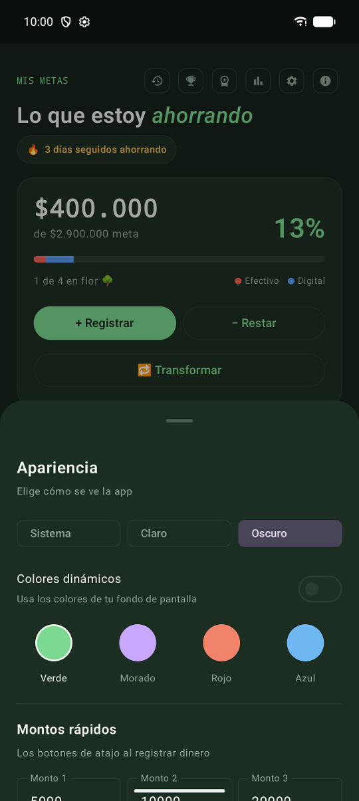
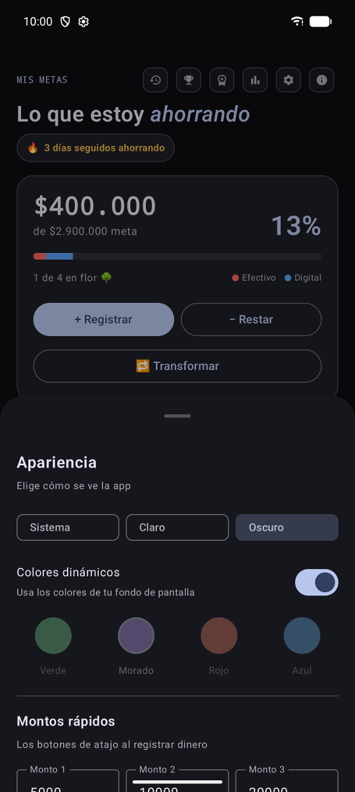
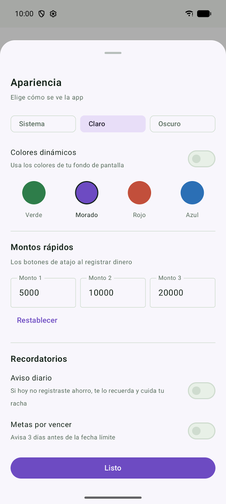
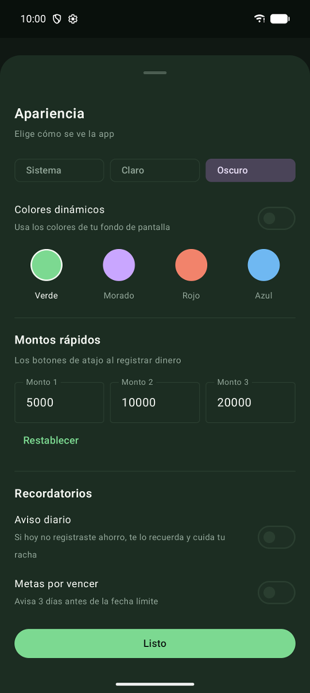
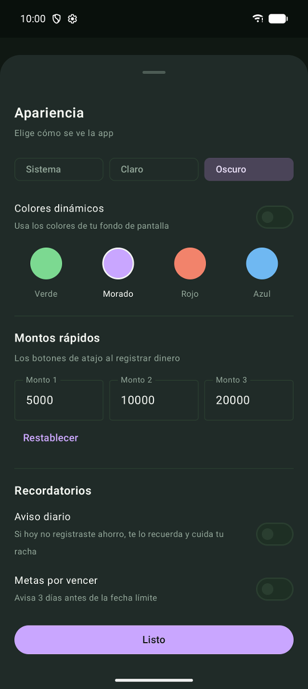

<!-- AUTO-GENERADO por tools/wiki/WikiGenerator.java. No editar a mano. -->
# Tema

> Página generada automáticamente desde el código. Para cambiarla, mejora el KDoc del código y corre `gradlew generateWiki`.

La app es oscura y cambia solo el color de acento. Los valores salen de `Theme.kt`.

## Colores base

| Nombre | Hex |
| --- | --- |

## Acentos

| Tema | Acento | Acento atenuado |
| --- | --- | --- |
| `GREEN` | `#7CD991` | `#4F8461` |
| `PURPLE` | `#C9A6FF` | `#7C5CC4` |
| `RED` | `#F2836B` | `#C24F3B` |
| `BLUE` | `#6FB8F2` | `#3E7FBF` |
| `GREEN` | `#2E7D4A` | `#7CD991` |
| `PURPLE` | `#6D4BC2` | `#C9A6FF` |
| `RED` | `#C24F3B` | `#F2836B` |
| `BLUE` | `#2B6FB5` | `#6FB8F2` |

<table><tr>
<td align="center"></td>
<td align="center"> colores dinamicos</td>
<td align="center"> modo claro</td>
<td align="center"> montos y recordatorios</td>
<td align="center"> tema morado</td>
</tr></table>

Código: [`Theme.kt`](../../app/src/main/java/com/alex/metasahorro/ui/theme/Theme.kt)
